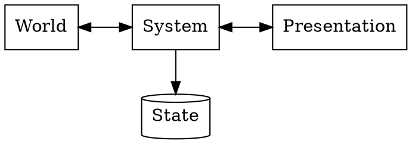
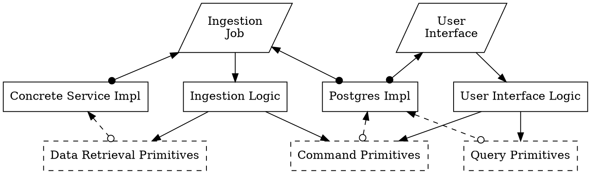

Languages and layers are everywhere in software engineering from the beginning, and in mathematics before that. Every piece of business software is, at its heart, based around the transformation of data into a more comprehensible form within a business domain or the solicitation of relevant data from people or systems.

Software engineering has focused on the _system_ and the _presentation_ in this formula. "Back-end developers" focused on the former, and "front-end developers" focused on the latter. This was justifiable, even necessary, before the AI era; there was enough complication and tedium in both domains to sustain relatively well-compensated programmers.

Romantic ideas of artisanal code aside, that era is gone.

The motivations for software systems haven't changed, though. Almost all business software still needs to transform data for consumption (human or otherwise). The difference is that the costs of change have shifted. In the past, writing code in itself was expensive, and a great deal of work went into the separation of concerns to minimize that cost when components with different velocities of modification interacted.

Put more simply, the separation of the processing and presentation layers was important, in part, because the former typically changed less frequently (or less drastically) than the latter.

With the use of LLMs, that calculus changes. You can define an entire application, soup to nuts, with a single prompt, tweak it over the course of a conversation, and declare yourself a visionary who is revolutionizing the tech industry.

You can modify your product inscrutably, including complete rewrites, without even thinking about the implicit requirements that are being violated and forgotten along the way. The management of entropy through separation of concerns seems unnecessary because the cost of change seems so low. "Back-end" and "front-end" seem old-fashioned, because the clankers are superhuman.

This perspective is correct, in a sense: back-end and front-end _are_ old-fashioned, but not because LLMs are superhuman. Instead, they're old-fashioned because LLMs can't learn and tolerate ambiguity the way humans can.

You can direct a junior developer by saying: "Anything that touches the database or an external system lives in the back end." That's often enough direction. In a well-factored system and in a team with an effective culture of code review, they will build comprehension of the project's patterns themselves and through peer reinforcement. Even in the worst case, a bad new hire can increase entropy only so much. LLMs, on the other hand, will "lawyer" their way around any loose rules and can generate entropy bounded only by your company's token budget.

Managing this capacity for unbounded entropy is the new imperative. Whereas enabling quick iteration on the presentation layer was once a major motivator, constraining quick iteration to reduce the blast radius of change is a larger concern now.

For an example of common practice that no longer makes sense, consider `stringUtils.java`, `input_helpers.py`, and their equivalents at the root of practical systems. These are toil-relieving conveniences for humans, usually accumulating over time and spawning small tech debt tickets for junior developers and summer interns. Now they represent opportunities for context leaks and misbehavior because of broken modular boundaries.

The same problem exists everywhere. Agent attention is inscrutable, so having the construction of SQL or the semantics of a particular ORM in context means that those concepts may pollute the rest of the implementation. Worse, knowing _about_ unintended concepts tends to pollute the clanker's "thinking."

In other words, the "three layer application" can still serve as a model, but those layers must be thinner and more strictly bounded to allow evolution within the layer itself and minimize necessary context. Network boundaries were traditionally the context horizon for humans, so thinking of modular boundaries as strict separation requires a significant change for most developers.

Consider this application architecture:

In this system, all of the dashed boxes represent modules that provide morphemes for the language of the system but don't concern themselves with implementation. Logic is implemented purely in terms of that systemic language. That means that the ingestion logic knows what data it needs to extract from an external system (`GetServerList`, `ListTaxDocuments`, ...) and that it needs to insert them in the database (`server_list |> Commands.SaveServer`, ...), but not how either of those needs to be accomplished. The Postgres implementation and the concrete service implementation, on the other hand, know only the commands that they need to implement, and do so without reference to the _use_ of those commands.

Only the processes at the top layer know about both the abstract logic and its concrete implementation. This is where any leaks accumulate ("Construct a Postgres transaction if the workflow performs updates...") and where the metaphors might be messiest. It's also where the direction to the clanker must be most restrictive, and preferably externally enforced:

> Using the Azure service implementation and Postgres, implement a batch job to store network data using `Ingestion/StoreNetworkMap`. Immediately stop and ask questions if anything is unclear or if an interface is inadequate. Do not read or modify any code beyond the public interfaces...

This method throws different approaches to programming language design into sharp relief. None of the ideas I'm advocating in this essay are new. They're covered in prominent books and papers from the 1960s to the 1980s, but most programming languages err on the side of enforcing separation only conventionally[^waah] or with insufficient expressive power.[^int]

[^waah]: The "we're all adults here" mentality. Of course, this had already proven itself inadequate even before LLMs arrived.
[^int]: This was often a "practical" trade-off in the 1990s and 2000s, but not always. Some languages choose to limit expressiveness on purpose.

To help yourself think about modules as the fundamental system boundary, consider studying languages with powerful modules or an equivalent. OCaml and Standard ML are the most direct examples, but Rust traits and Haskell typeclasses are also a powerful, expressive approach. Both Python and TypeScript can express many of the same ideas, but require care because their gradual type systems are (intentionally!) full of holes that the LLM can exploit without deterministic enforcement---which we'll cover in a later essay.

Once you're comfortable with the concept itself, think about every session with a clanker in terms of a single goal aimed at constructing that graph above:

- Providing morphemes for your system's language.
- Constructing logical "sentences" based on those morphemes.
- Expressing those morphemes in relation to external systems.
- Building processes that fulfill your "sentences" with concrete actions.

If you're disciplined, you'll soon find that you are efficiently cycling back to previous layers, extending them as necessary, and never relying on a model to provide continuity. Just as human developers once specialized in "front-end" and "back-end" work, your agents can specialize in single modules of your system.

## Further Reading

As mentioned, the concepts here are not new except in their relationship to co-programming as a particular discipline. I think these four papers are particularly useful to build your intuition for the approach:

- ["On the Criteria to Be Used in Decomposing Systems into Modules."](https://dl.acm.org/doi/epdf/10.1145/361598.361623) Parnas, 1972. This is the classic "information hiding" paper, often treated as controversial when information hiding at the code level seemed like a sociological problem.
- ["Programming with Abstract Data Types."](https://dl.acm.org/doi/epdf/10.1145/800233.807045) Liskov and Zilles, 1974. Explains the expression of implementation-independent operations at the type level.
- ["Hints for Computer System Design."](https://www.microsoft.com/en-us/research/wp-content/uploads/2016/02/acrobat-17.pdf) Lampson, 1983. A relatively long and general discussion of system design principles. Sections 2 and 2.2 are particularly relevant.
- ["Programming as Theory Building."](https://gwern.net/doc/cs/algorithm/1985-naur.pdf) Naur, 1985. Discusses the gradual accumulation of human knowledge in traditional teams, and the risks of the loss of implicit requirements.

If you're interested in the ideas behind modules as a powerful abstraction in their own right, ["Modules for Standard ML"](https://dl.acm.org/doi/epdf/10.1145/800055.802036) is also worth reading.
