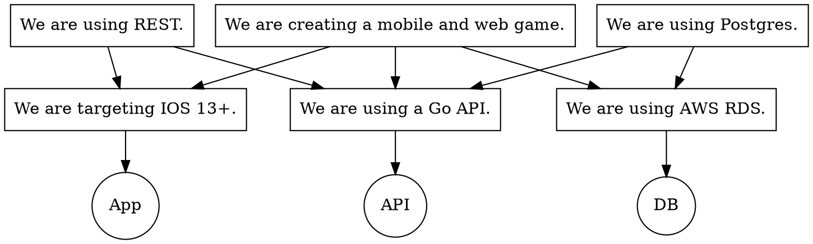

Test driven development ("TDD") became a prominent programming fad in the late 2000s and early 2010s. Its distinction from traditional testing is the **red-green-refactor cycle**---the idea that you should express a novel requirement as an executable test, add code to make that test pass, and then refactor to make that code _good_.

Not long after I first encountered TDD as a concept, I also encountered a [Hacker News comment][hnc] that linked to Ron Jeffries, a prominent TDD advocate, attempting to write a Sudoku solver. He failed badly because he was unaware of the core algorithm necessary to solve Sudoku[^1] and TDD doesn't offer guidance toward the solution of a novel problem.

[hnc]: https://news.ycombinator.com/item?id=3033446
[^1]: Since Sudoku was very popular, there are interesting papers discussing approaches to solving it. Simonis' ["Sudoku as a Constraint Problem"](https://ai.dmi.unibas.ch/_files/teaching/fs13/ki/material/ki10-sudoku-inference.pdf) is the most important.

To put a name to Jeffries' problem, the tests he was implementing lacked **conceptual power**. They documented that he was implementing what he intended, but they didn't provide the concepts that he needed to implement the right thing.

Clankers haven't made the situation better on this front. They write voluminous tests, because their training material reinforces this as good engineering practice, but those tests are low-information slop that isn't worth reading. That's not a new problem with test code; practical human teams often treated it as disposable for the same reason, but that reason wasn't as obvious as it is now. Tests often have both low power and low **context efficiency**.

In other words: they don't explain very much, and they use a lot of words to do it.

Co-programming requires that we keep these ideas in mind because we need both conceptual power and context efficiency to steer the clanker as it works on a large project. Core design ideas must be respected, and to be respected they must be in effective context throughout the workflow. If three million tokens of low-value unit tests fill the context window, the core insights and design constraints will be lost.

If you read "[Three Questions][tq]," its technique is relevant here: teasing out boundaries allows reducing the scope of rules to make sure they remain accessible and relevant. Consider a common constraint: in the context of a mobile app, _"We are targeting iOS 13+"_ is vital, but it's irrelevant when your web API converses with Postgres. Unit tests that ensure your mobile app's conformance should be invisible to the web API and absent from its context.

[tq]: {{ "/essays/three-questions/" | url }}

Boundaries require strictness that seemed unnecessary and constrictive for human teams, because LLMs lack judgment. Context efficiency collapses as soon as any boundary trustworthiness is lost. When a clanker finds itself needing to pull in additional code to verify behavior or chase down a problem, I think of that as a **context leak**, costing system context efficiency just as a memory leak costs memory efficiency.

An interesting side effect is that rules with low conceptual power that are important for implementation should be pulled as close to that implementation as possible. Flexibility is pure cost. The Ruby ethos of "maximizing developer happiness" is clearly _wrong_ in co-programming environments; LLMs don't feel "happy," don't build a heuristic understanding of a codebase over time, need specification for how a function should behave, and need that specification to respect their context budget.

Bluntly, static types have won. They cannot be replaced by unit tests because the static type is an exclusive, parsimonious declaration of validity over the potential value-space, whereas unit tests are positive assertions of truths that can never be extended to the same breadth. The former can be thought of as limited proofs while the latter cannot.

<aside>
Consider a function called `add` in a dynamically typed language. If you call `add 6 7`, you might be surprised when you receive `"67"` in response. You encode it as a unit test. When you call it next, though, with `add 10 5`, you get `15`. Strange! You encode another unit test. However, if you encountered `add` in a statically typed language with a type annotation of `add (x: Int) (y: Int) : Int`, `add 6 7 == "67"` is impossible.

These types don't prove _correctness_, but they do eliminate a class of errors that tests alone can't constrain. We'll discuss complementary, conceptually powerful tests called **property-based tests** in a future essay.
</aside>

The same is true at larger boundaries. APIs designed to minimize developer toil are counter-productive because toil is cheap. For example, GraphQL requires understanding a schema holistically and is no longer a good choice for UX-to-API or machine-to-machine API implementations. It was designed for a period when the UX developer was a _human consumer_ of the API.

To think about this within your own projects, look at your session logs as you work on a new feature. Does the LLM read or modify many files? Does it run irrelevant test suites, or invent new ones? Does it respect human-provided rules with high conceptual power, or does it forget them as sessions wear on?

Give your clanker boundaries it can trust and prove.
