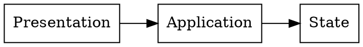
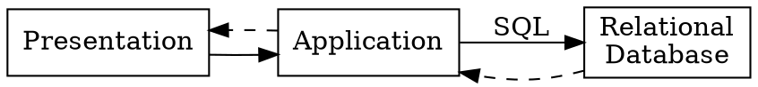
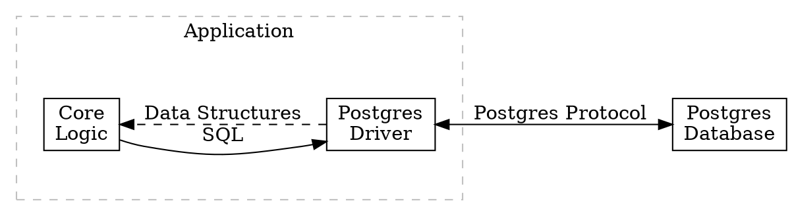

It's easy to say "build your system as a language" and smile enigmatically as your interlocutor looks at you without comprehension. Before our robot friends arrived, it was sometimes even enough to get you Senior Staff Architect titles and speaking gigs.[^1] Afterward, though, it's more likely that your intended student will go off, ask his clanker, and get a nonsensical answer that leads to even worse sloppification of his code.

[^1]: Any resemblance to actual persons, living or dead, is purely coincidental.

The core rule of co-programming is that the human must always supply _judgment_ (or _taste_, if you prefer). For any design tool to be meaningful in this era, you must be able to decide on firm direction to specify as a rule, and developing that judgment requires that you understand the heuristics that guide those decisions.

Luckily, a lot of constraints come from external requirements, and three questions let you begin to ask the _other_ questions that are relevant:

1. How will my system receive its **input?**
2. How will my system deliver its **output?**
3. What is my system's **execution environment?**

If we're very lucky, our system is dead simple and we can answer these immediately:

> "Well, we're writing a command line tool, so we'll receive input via `stdin`. We'll write our output to `stdout`. It'll be executed on-demand by the user in a Unix-like environment."

If you've read programming books, you might recognize these as the implicit answers assumed by most book authors. It's wonderful to be able to answer the questions in a standard way: these answers power the Unix philosophy and all of the tools it has enabled.

Command line utilities aren't a growth market in 2026, though. Our answers are more likely to look like this:

> "We need a web interface, so we'll receive input via the web browser and send output the same way. We're going to run on a serverless platform."

Those answers may as well be a blank map marked "Dragons!" but they represent seeds for further investigation. For example:

- Is the session for your web app intended to be shared between a user's devices?
- Is data specific to a single user or can others interact with it?
- Is sensitive or proprietary data being used?

If we're building a system that requires server-side processing and persistent state, we're creating a classic "three-tier web app" that's divided into a "presentation tier," an "application tier," and a "state tier."

Another way to think about this is that we're building a system with three subsystems---and we can ask the three questions about each of them. Consider the State tier first:

<dl>
<dt>How will it receive input?</dt>
<dd>Well, the system we're building is transactional and will need strong consistency, so I want to use a traditional relational database. We might also have read-only reports and our analysts can write those in SQL.</dd>
<dt>How will it send output?</dt>
<dd>Of course, this will be across the network, but it'll mainly be from our own application. Analysts probably need read-only access to query, too, so we need a system that their tools support.</dd>
<dt>What is its execution environment?</dt>
<dd>I guess it needs to be as close to the app as possible, so if the same cloud provider has relational database options, we should use them.</dd>
</dl>

Notice that none of these questions are "final." They are seeds for further investigation, a set of three basic "starter questions" that you can use to continue discovering the shape of the system you want to build without being led on a wild goose chase.

They also reveal boundaries, and boundaries are where the languages of a system can be enforced. Let's revisit that simple diagram above:

Things are starting to fall out of the design: making each decision allows us to limit our search space and understand the languages that each layer will need to speak and comprehend. We can zoom in on the Application/Database relationship now, for example, and recognize based on our earlier answers that our cloud provider provides Postgres databases. That reveals a further question:

<dl>
<dt>How do we send SQL across the network to a Postgres database?</dt>
<dd>There is a protocol that Postgres provides that accepts queries and returns results, and most major languages have a driver.</dd>
</dl>

The map of the territory grows more detailed:

A word of caution: discuss these questions with your preferred clanker, but don't skimp on model capabilities for design and research, and don't allow the discussions to spiral into vibe coding. Coding and development are token-heavy, and LLM providers are incentivized to push you toward inefficient, "agentic" workflows. Instead, ask your questions of a capable model[^2], think about the answers, and then blow away the context for that chat.

Always remember that the goal is to refine and preserve your own judgment. You owe your clanker nothing.

[^2]: Watch multiple benchmarks. The validity of most of them varies over time as the benchmarks become saturated and as new models learn to cheat on them. [LiveBench](https://livebench.ai) and [Artificial Analysis](https://artificialanalysis.ai/) seem like good options, as of late 2026.
